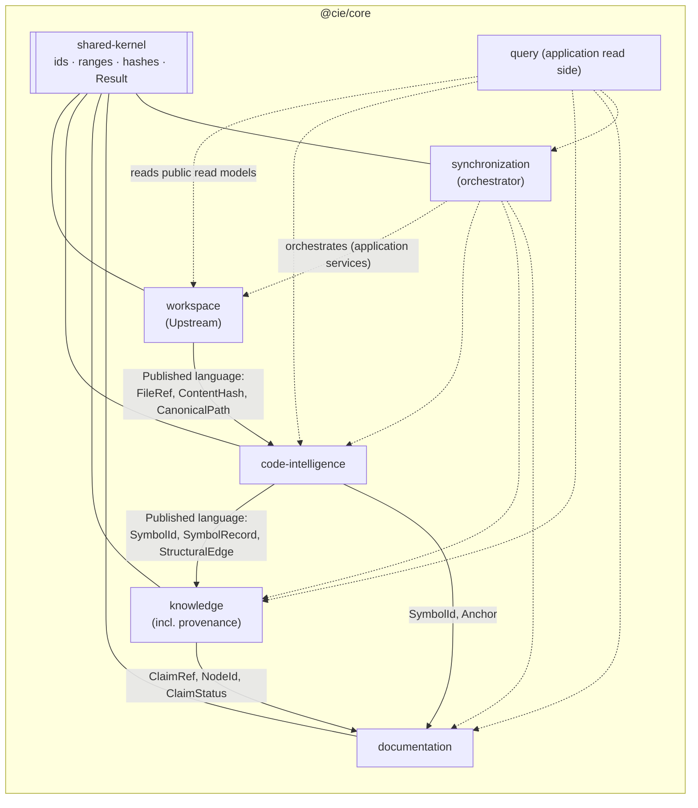

# Bounded Contexts

> Status: Baseline v0.1 · Related: [DOMAIN_MODEL](DOMAIN_MODEL.md), [DEPENDENCY_RULES](DEPENDENCY_RULES.md), ADR-0001

## 1. Evaluation of the candidate contexts

The brief proposed seven candidate contexts. Each one is evaluated by asking: **does it have its own language, its own consistency rules, and its own rate of change?**

| Candidate | Verdict | Rationale |
|---|---|---|
| Workspace Management | **Keep: `workspace`** | Owns roots, ignore rules, path canonicalization and file manifests. Its isolation and path-safety rules (WS-*) are security-critical and must not be spread across contexts. |
| Code Intelligence | **Keep: `code-intelligence`** | Owns language adapters, symbols, references and dependencies. It changes with language support, not with documentation features. |
| Knowledge Management | **Keep, merged with Provenance: `knowledge`** | Claims and evidence form one consistency boundary. A claim's status is valid only relative to its evidence (PV-001), and splitting them would require a cross-context transaction for every status change. |
| Provenance and Evidence | **Merge into `knowledge`** | See above. Provenance is a cross-cutting *language* (evidence kinds, producers), and it is published from `knowledge` for other contexts to reference. |
| Documentation Management | **Keep: `documentation`** | Owns pages, sections, ownership, links and conflicts. It has distinct rules (DOC-*) and a distinct medium (Markdown files). |
| Synchronization | **Keep: `synchronization`** | Owns revisions, jobs, leases, change sets, watermarks and staleness propagation. It orchestrates the other contexts, and its rules (SN-*) concern time and concurrency rather than content. |
| Integration and Query Interfaces | **Not a domain context.** It is an application read-side module (`core/query`) plus transport adapters. | It has no invariants of its own beyond API conventions (API-*). It composes read models of the other contexts, so treating it as a domain would create an anemic context that duplicates other models. |

**Result: five domain contexts plus one application-level query module.**

## 2. Context map



Relationship types (DDD terms):

| Upstream → Downstream | Relationship | Notes |
|---|---|---|
| workspace → code-intelligence | Customer/Supplier | CI consumes canonical file refs and never re-derives paths. |
| code-intelligence → knowledge | Customer/Supplier with a **Published Language** | Structural edges enter knowledge as claims with intrinsic, deterministic evidence. |
| knowledge → documentation | Customer/Supplier | Documentation references claims and nodes by ID only. |
| code-intelligence → documentation | Conformist (IDs only) | Docs reference `SymbolId` and `Anchor`. |
| synchronization → all | Orchestrator (application layer only) | Its **domain** depends only on the shared kernel. Its **application** layer calls the other contexts' public application services. |
| query → all | Read-side consumer | Read-only. It never calls command-side application services. |

## 3. Anti-corruption layers (ACLs)

| Boundary | ACL location | Purpose |
|---|---|---|
| Language tooling (tree-sitter nodes, TS `ts.Node`/`ts.Symbol`, SCIP occurrences) → CIE symbols | `adapters/lang-*` implement `FileExtractor`/`ProjectResolver` | Third-party AST types never cross the port. Adapters emit CIE `FileExtraction` value objects. |
| LLM responses → claims and prose | `knowledge/application/InferenceIntake` + `adapters/llm-*` | Schema-validate the response, resolve cited IDs and force status `inferred` (AI-001..003). |
| Markdown files → pages | `adapters/markdown` → `documentation/application/PageParser` port | The parser emits a `ParsedPage` (front matter, sections, markers, links). Remark/markdown-it types stay inside the adapter. |
| Core read models → wire DTOs | `@cie/runtime/protocol-mapping` | Versioning seam. Core types never appear in `@cie/protocol`. |
| CodeForge types ← CIE DTOs | **CodeForge-side adapter** (outside CIE) | CIE never imports CodeForge (see CODEFORGE_INTEGRATION). |

## 4. Shared kernel (deliberately tiny)

Contents, as an allow-list enforced by FF-CPX-004:

| Item | Description |
|---|---|
| Branded ID types | `WorkspaceId`, `RevisionSeq`, `SymbolId`, `NodeId`, `ClaimId`, `EvidenceId`, `PageId`, `SectionId`, `JobId` |
| `CanonicalPath` | Branded string. Its constructor is in `workspace`, but the type lives in the kernel. |
| `SourceRange` | `{startLine, startCol, endLine, endCol}`. 0-based lines, UTF-16 columns, end-exclusive. |
| `ContentHash` | `sha256:<hex>` |
| `Result<T, E>`, `DomainError` base | — |
| `Clock` and `Hasher` port **interfaces** | Pure types, no implementations |
| `CancellationSignal` | A minimal structural interface (`aborted`, `reason`, `addEventListener('abort', …)`) that the global `AbortSignal` satisfies. The core cannot reference `AbortSignal` itself: it uses no Node or DOM lib types (FF-DEP-002b). Adapters and the runtime pass real `AbortSignal`s. |

Anything else proposed for the shared kernel needs an ADR. This prevents the "uncontrolled shared utility module" anti-pattern (brief §5).

## 5. Ownership summary

| Concept | Owning context |
|---|---|
| Workspace, RepositorySnapshot (manifest), SourceFile, IgnorePolicy | workspace |
| Symbol, SymbolReference, Dependency (import / call / type edges), LanguageAdapter, CapabilityProfile, Anchor | code-intelligence |
| KnowledgeNode, KnowledgeRelation, KnowledgeClaim, Evidence, Concept, ArchitectureComponent | knowledge |
| WikiPage, Section, Link, DocumentationRevision (section write log), Conflict | documentation |
| IndexRevision, IndexJob, Lease, ChangeSet, ChangeEvent, Watermark, SymbolLineage | synchronization (lineage is *computed* by a code-intelligence domain service and *recorded* by synchronization) |

## 6. Mapping to code (Phase 00 scaffold)

```
packages/core/src/
  shared-kernel/               (allow-listed files only)
  workspace/        domain/  application/  public.ts
  code-intelligence/domain/  application/  public.ts
  knowledge/        domain/  application/  public.ts
  documentation/    domain/  application/  public.ts
  synchronization/  domain/  application/  public.ts
  query/                     application/  public.ts     (no domain/)
  index.ts                   (re-exports public.ts files only)
```
