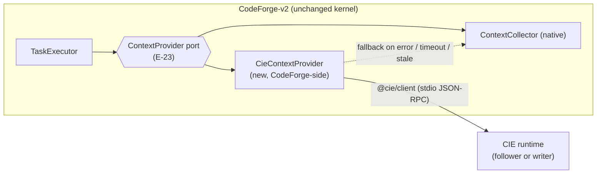

# CodeForge-v2 Integration (Future Consumer)

> Status: Baseline v0.1 · Related: O7, PUBLIC_API_CONTRACT, E-20..E-30
> CodeForge-v2 was inspected **read-only**. Nothing in this document requires changes to CIE that depend on CodeForge internals. Everything CodeForge-specific lives **in CodeForge**.

## 1. Constraints (hard)

| # | Constraint | How it is guaranteed |
|---|---|---|
| CF-1 | CIE does not know TaskGraph, Policy, ToolGateway, VerificationEngine or the Governance Kernel | FF-DEP-004 forbids `@codeforge/*` imports and CodeForge paths. No CodeForge vocabulary appears in `@cie/protocol`. |
| CF-2 | CodeForge consumes CIE only through public interfaces | `@cie/client` + `@cie/protocol` (JSON-RPC stdio), or MCP |
| CF-3 | CIE remains advisory | Query profile only; all CIE output is untrusted data in CodeForge (E-30) |
| CF-4 | CIE gains no autonomous code execution authority | SEC-002, SEC-004; CIE exposes no execution method |
| CF-5 | CIE is not part of the CodeForge Governance Kernel | CIE is never on CodeForge's decision path. CodeForge's deterministic runtime decides (E-25), and CIE output only enters context assembly. |

## 2. What CodeForge expects from an advisory knowledge source

These expectations are derived from the evidence. Each one is an [Assumption] about CodeForge's needs, to be confirmed with CodeForge's own planning.

| Expectation | Evidence | CIE answer |
|---|---|---|
| Never throw; degrade to empty | `ContextProvider`/`ContextCollector` contract (E-23) | The CodeForge-side adapter wraps `@cie/client` calls in try/catch with deadlines, and falls back to CodeForge's native collector |
| Deterministic ordering | Deterministic retriever, sorted outputs (E-24) | CIE orders ties by ID (KNOWLEDGE_GRAPH_DESIGN §8.1) |
| Bounded results | Token budgeter, max files and bytes (E-23) | `limit`, `maxDepth`, `evidence: 'count'` |
| Revision binding / staleness | `ContextSource.revisionId`, `CONTEXT_REVISION_STALE` (E-25) | Envelope `revision.seq` + `freshness`, plus per-file `contentHash` so CodeForge can compare against its own workspace view |
| Untrusted marking | Workspace content is T4 untrusted (E-30) | Adapter maps all CIE content to untrusted `ContextItem`s or `RagItem`s |
| Flag-off parity | AdviceGate and flag-off parity principle (E-25) | `cie.enabled=false` (CodeForge config) means the adapter is not constructed, so behavior is byte-identical |
| Timeouts and cancellation | Per-request timeouts in LSP adapter / ToolGateway (E-23 context) | `_meta.deadlineMs`, `$/cancelRequest` |
| Typed error codes | String-union codes on Error subclasses (sub-agent report) | `cieCode` (PUBLIC_API_CONTRACT §7) |

## 3. Adapter design (lives in CodeForge, owned by CodeForge)

A sketch of `CieContextProvider.collect(changedPaths?, plan?)` in CodeForge terms:

1. Read `workspace.status` with a short deadline. If the result is `CIE_INDEX_NOT_READY`, an error, or `freshness = unknown`, delegate to the native collector.
2. Compute `workspaceFiles`. CodeForge keeps reading files itself, because CIE does not ship file contents.
3. Build `symbols`:
   - For changed paths, call `symbols.outline` per changed file.
   - Call `impact.affectedSymbols` for the changed set (`maxDepth` from the plan), and map the results to `RetrievedSymbol`.
4. Build `importReverseEdges` from `dependencies.query {direction: 'in', types: ['imports']}` on the changed files.
5. Optionally build `RagItem`s from `concepts.search` / `wiki.getPage` sections relevant to the goal, with `source: 'doc'`.
6. **Staleness gate.** For each file-backed item, compare the CIE `contentHash` against CodeForge's current hash. If they differ, drop the item. This mirrors CodeForge's `CONTEXT_REVISION_STALE` semantics (E-25).
7. All errors degrade to the native result. The provider never throws.

## 4. DTO mapping table

| CodeForge type (E-23, E-24, E-25) | Field | CIE source | Mapping rule |
|---|---|---|---|
| `ContextSignals` | `workspaceFiles: Map<path, content>` | — | CodeForge reads files itself (CIE does not transfer content) |
| | `symbols: RetrievedSymbol[]` | `symbols.outline`, `impact.affectedSymbols` | See `RetrievedSymbol` rows |
| | `importReverseEdges: Map<path, Set<path>>` | `dependencies.query` (in, imports, file-level) | `edge.to.path → set of edge.from.path` |
| | `changedPaths` | passthrough | — |
| `RetrievedSymbol` | `file` | `SymbolDTO.location.path` | Same canonical `/` relative form |
| | `name` | `SymbolDTO.name` | — |
| | `kind` | `SymbolDTO.kind` | `function, class, variable, interface, type, enum, method, constructor` map 1:1. `property` → `variable`, `module` → skip, others → skip. CodeForge's union is closed. |
| | `startLine` / `endLine` (0-indexed) | `location.range.startLine` / `endLine` | CIE is 0-based too. CIE's `endLine` is the line containing the end position, so no conversion is needed. |
| | `exported` | `SymbolDTO.exported` | — |
| `RagItem` | `source` | — | `'doc'` (the closed union is `'doc' \| 'repo'`) |
| | `path` | `wiki.getPage` → `page.path` | — |
| | `content` | Section text, **generated sections prefixed with a status line** (`[CIE inferred, rev 42]`) | Truncated to the CodeForge budget |
| | `score` | Search score, normalized to 0..1 | Deterministic |
| | `reason` | `cie:concept:<id>@<seq>` / `cie:page:<id>@<seq>` | Provenance string |
| `ContextSource` (if mapped to `ContextItem`) | `revisionId` | **Not mapped.** CodeForge's revision concept differs. | Use the `contentHash` check (step 6) instead. Put `seq` in `reason`. |
| | `externalUrl` | `cie://symbol/<id>` or `cie://wiki/<pageId>` | — |
| | `symbolName` | `SymbolDTO.qualifiedName` | — |
| Advice (`RawContextRerankAdvice`) | `deltas: path → delta` | `impact.affectedSymbols.depth` / weakest status | **Optional, alternative path.** CIE supplies only rerank signals, which CodeForge's AdviceGate clamps (E-25). This is the least intrusive integration. |

## 5. Deployment options for CodeForge

| Option | Description | Trade-off |
|---|---|---|
| A. CodeForge spawns its own CIE runtime (follower if VS Code already runs a writer) | `@cie/client.spawnRuntime({workspaceRoot})` | Simple. Two processes may exist, but the lease prevents conflicting writers (ADR-0002). |
| B. CodeForge uses CIE via MCP | Generic MCP client | Only if CodeForge adds MCP client support. [Fact] It has none today (E-29). |
| C. CodeForge reads exported JSON (`cie export`) | Offline snapshot | No freshness; useful for benchmarks and evaluation only |

**Node compatibility.** CodeForge declares `node >=20` (E-20), while the CIE runtime requires Node ≥24 (ADR-0004). Because the runtime is a separate process, the only code CodeForge loads is `@cie/client`, which targets broader Node support ([Proposal]: compatible with Node ≥20; it uses only `child_process` and `stream`). CodeForge may still need to point the spawn at a Node ≥24 binary. **OQ-11.**

## 6. Explicit prohibitions

- No CIE package imports, references or mentions CodeForge kernel types.
- No CIE method accepts CodeForge task, goal or policy objects.
- No CIE component calls back into CodeForge.
- CIE never returns "instructions" to an agent. Wiki content is data, and generated text is labeled with its status.
- The CodeForge adapter is maintained in the CodeForge repository. CIE provides only `@cie/client`, `@cie/protocol` and a contract test kit (`@cie/protocol/testing` fixtures, [Proposal]) that CodeForge can run.

## 7. Open on the CodeForge side (not CIE decisions)

| ID | Question |
|---|---|
| CFQ-1 | Should CIE symbols replace or augment CodeForge's native `ContextCollector` symbols? (Recommendation: augment first, with flag-off parity.) |
| CFQ-2 | Should `RagSource` gain a `'cie'` member for clearer provenance, instead of reusing `'doc'`? |
| CFQ-3 | Who owns the CIE runtime lifecycle when both the CodeForge VS Code extension and the CIE extension run? |
| CFQ-4 | Does CodeForge want the advice (rerank) path, the context path, or both? |
| CFQ-5 | Which CodeForge invariant IDs (ME-*/LE-*/CX-*) should the adapter's tests cite? |
