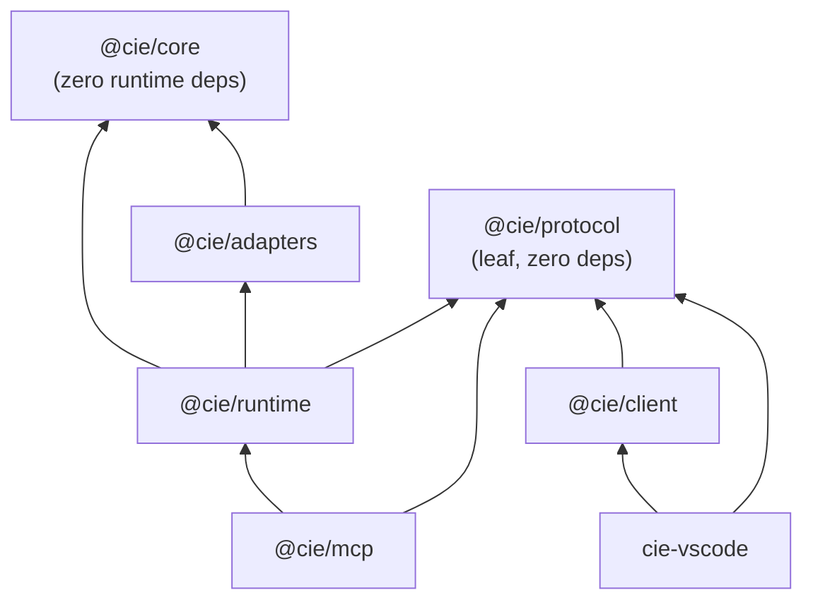

# Dependency Rules

> Status: Baseline v0.1 · Enforced by: [ARCHITECTURE_FITNESS](ARCHITECTURE_FITNESS.md) (FF-DEP-*, FF-BND-*) · Related: ADR-0001, ADR-0005

## 1. Package dependency graph (allowed edges only)

## 2. Allowed-dependency matrix

Read the table as "row may import column". ✅ allowed · ❌ forbidden · ➖ not applicable.

| from \ to | protocol | core (public) | core (internal) | adapters | runtime | client | mcp | vscode-ext | node: built-ins | 3rd-party npm |
|---|---|---|---|---|---|---|---|---|---|---|
| **protocol** | ➖ | ❌ | ❌ | ❌ | ❌ | ❌ | ❌ | ❌ | ❌ | ❌ |
| **core** | ❌ | ➖ | ✅ (rules §3) | ❌ | ❌ | ❌ | ❌ | ❌ | ❌ | ❌ |
| **adapters** | ❌ | ✅ | ❌ | ✅ own subfolder only | ❌ | ❌ | ❌ | ❌ | ✅ | ✅ (allow-list per subfolder) |
| **runtime** | ✅ | ✅ | ❌ | ✅ | ➖ | ❌ | ❌ | ❌ | ✅ | ✅ (CLI arg parser, JSON-RPC framing) |
| **client** | ✅ | ❌ | ❌ | ❌ | ❌ | ➖ | ❌ | ❌ | ✅ (`child_process`, `stream`) | ❌ |
| **mcp** | ✅ | ❌ | ❌ | ❌ | ✅ (`createProtocolHandler` only) | ❌ | ➖ | ❌ | ✅ | ✅ (`@modelcontextprotocol/sdk`, `zod`) |
| **vscode-ext (host)** | ✅ | ❌ | ❌ | ❌ | ❌ | ✅ | ❌ | ➖ | ✅ | ✅ (`vscode` types) |
| **vscode-ext (webview)** | ✅ (types only) | ❌ | ❌ | ❌ | ❌ | ❌ | ❌ | `shared/messages.ts` only | ❌ | ✅ (React, markdown-it, DOMPurify) |

**Universal prohibitions:**
- No `@codeforge/*` import and no path into the CodeForge repository, from any CIE package (FF-DEP-004).
- No circular dependencies at the package level or the module level (FF-DEP-001).

## 3. Rules inside `@cie/core`

| # | Rule | Rationale |
|---|---|---|
| C1 | `*/domain/**` may import only its own context's `domain/**` and `shared-kernel/**`. | Pure domain |
| C2 | `*/application/**` may import its own `domain/**`, `shared-kernel/**`, and **other contexts' `public.ts`**. | Explicit published language |
| C3 | Cross-context imports **must** target `<context>/public.ts`. Deep imports into another context are forbidden. | Prevents erosion |
| C4 | `domain/**` never imports `application/**`. | Dependency direction |
| C5 | Context dependency order is acyclic: `workspace ← code-intelligence ← knowledge ← documentation`. `synchronization/application` may depend on all four. `query` may depend on all five. **No context may depend on `synchronization` or `query`**, except through events passed in by the dispatcher. | Acyclic contexts |
| C6 | `shared-kernel/**` imports nothing outside itself, and its file set is allow-listed (`governance/shared-kernel.allowlist`). | Prevents a dumping-ground "utils" module |
| C7 | No folder named `utils`, `helpers`, `common` or `misc` anywhere in `packages/*/src`, except `shared-kernel`. | Brief §5: uncontrolled shared utilities |
| C8 | (Revised in Phase 03, P03-05: the v0.1 text allowed `synchronization/application`, which C3 forbids from deep-importing another context.) `knowledge/domain/verification/**` (ClaimVerifier and capability token) is importable only from the knowledge context (`knowledge/**`), the runtime composition root (`runtime/src/composition/**`) and tests. It is not re-exported from `@cie/core`. Its only published form is the `@cie/core/verification` subpath. Other contexts, `synchronization/application` included, receive verification as an injected dependency. | AI-002 / PV-002 |

## 4. Rules inside `@cie/adapters`

| # | Rule |
|---|---|
| A1 | Each subfolder (`sqlite`, `fs`, `treesitter`, `lang-ts`, …) is independent. It may import only `@cie/core` public exports and its own files. Shared adapter code needs an ADR. |
| A2 | Third-party libraries are allow-listed per subfolder, e.g. `better-sqlite3` → `sqlite` only; `web-tree-sitter` → `treesitter` only; `typescript` → `lang-ts` only; `node:child_process` → `process` only. |
| A3 | Adapters never call other adapters directly. Composition happens in `@cie/runtime/composition`. |
| A4 | `llm-openai-compatible` exports only a factory consumed by `runtime/composition/guardRemote` (SEC-003). |

## 5. Forbidden-import catalog (core and protocol)

| Module pattern | Forbidden in | Reason |
|---|---|---|
| `vscode` | everything except `packages/vscode-extension/src/host` | O1 |
| `react`, `react-dom`, `vite`, `esbuild`, `markdown-it`, `dompurify` | everything except `packages/vscode-extension` (and root dev tooling) | NFR-052 |
| `better-sqlite3`, `node:sqlite`, `sql.js` | everything except `adapters/sqlite` | Storage behind ports |
| `web-tree-sitter`, `tree-sitter*`, `typescript` (runtime import) | everything except `adapters/treesitter`, `adapters/lang-ts` | ACL |
| `ollama`, `openai`, any LLM SDK, `undici`/`fetch` wrappers | everything except `adapters/llm-*` | O6 / SEC-003 |
| `node:*` (all built-ins) | `packages/core`, `packages/protocol` | Pure core; also keeps the in-process option open (ADR-0002) |
| `node:child_process` | everything except `adapters/process`, `packages/client` | SEC-002 |
| `@codeforge/*`, `**/CodeForge*/**` | everywhere | O7 / independence |
| `@modelcontextprotocol/*` | everything except `packages/mcp` | ADR-0003 isolation |

`typescript` as a **type-only** dev dependency (via `import type`) is allowed everywhere. Only runtime imports are restricted.

## 6. Public API surfaces

| Package | Public entry | What is exported |
|---|---|---|
| `@cie/protocol` | `src/index.ts` → `v1/*` | DTOs, method names, error codes, envelope types. Pure types plus constant tables. |
| `@cie/core` | `src/index.ts` | Only what the contexts' `public.ts` and `query/public.ts` export: use-case factories, port interfaces, read-model types |
| `@cie/client` | `src/index.ts` | `CieClient` (typed per-method functions), `spawnRuntime()` |
| `@cie/runtime` | `bin/cie`, `src/index.ts` | `composeOutOfProcessRuntime`, `createProtocolHandler` |
| `@cie/mcp` | `bin` entry (`cie mcp`) | none |

`package.json` `exports` maps restrict deep imports at the package level. Internal paths are not exported.
