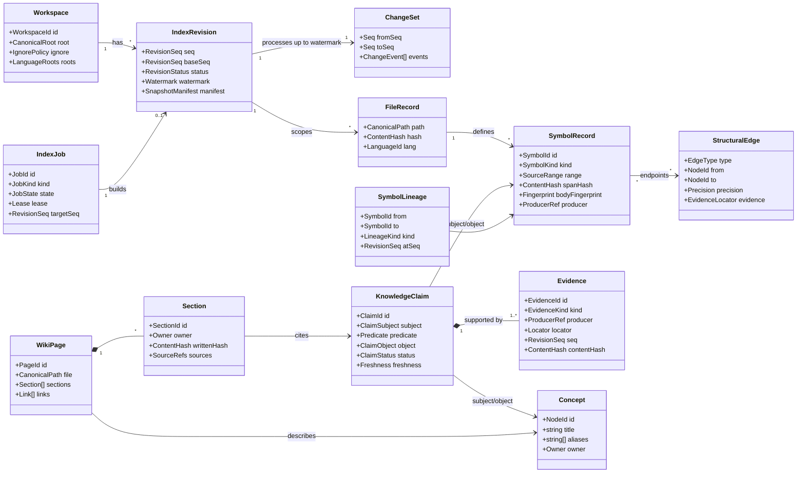
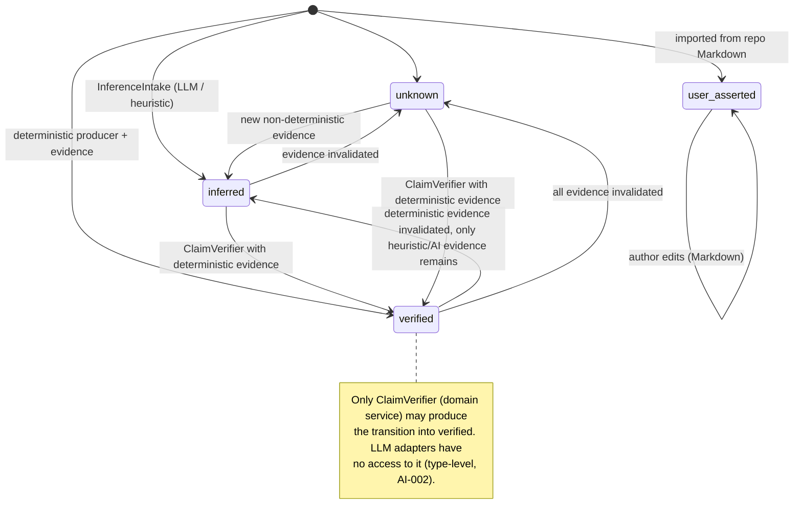

# Domain Model

> Status: Baseline v0.1 · Related: [BOUNDED_CONTEXTS](BOUNDED_CONTEXTS.md), [DOMAIN_INVARIANTS](DOMAIN_INVARIANTS.md), ADR-0014, ADR-0015

## 1. Modeling stance

**[Proposal] Aggregates exist only where a consistency rule must be enforced transactionally on a small object graph.**

Bulk structural facts are different. Millions of symbols, references and edges are produced by deterministic extraction, and **are not modeled as aggregates loaded into memory**. They are *revision-scoped records*:

- They are written through a `RevisionWriter` unit of work.
- They are validated in bulk by `RevisionValidator` before publish, using SQL checks plus sampled hash checks.
- They are read through query ports.

Enforcing invariants this way at bulk scale is deliberate, and it avoids the "aggregate per symbol" anti-pattern. Each invariant states which mechanism enforces it.

## 2. Concepts from the brief: placement

| Brief concept | Placement | Kind |
|---|---|---|
| Workspace | workspace | **Aggregate root** |
| RepositorySnapshot | workspace | **Value object** (`SnapshotManifest`): an ordered list of `(path, hash, size, lang)` plus the manifest hash. Not an entity, because it has no lifecycle of its own and is owned by an IndexRevision. |
| SourceFile | workspace | Revision-scoped record (`FileRecord`) |
| Symbol | code-intelligence | Revision-scoped record (`SymbolRecord`) with identity `SymbolId` |
| SymbolReference | code-intelligence | Revision-scoped record (`ReferenceRecord`) |
| Dependency | code-intelligence | Revision-scoped record (`StructuralEdge` of type `imports`, `calls`, `extends`, `implements`, `references_type`, …) |
| KnowledgeNode | knowledge | Revision-scoped record for structural nodes (projected from files and symbols). **Aggregate** for user/AI concept nodes (`Concept`). |
| KnowledgeRelation | knowledge | Record. Structural relations come from `StructuralEdge`; semantic relations are carried by a `KnowledgeClaim`. |
| KnowledgeClaim | knowledge | **Aggregate root** for non-structural claims (status machine + evidence set) |
| Evidence | knowledge | Entity within the Claim aggregate, or an *intrinsic* evidence locator on a structural record |
| WikiPage | documentation | **Aggregate root** (sections, ownership, links) |
| DocumentationRevision | documentation | Entity: `SectionWrite` log entry (section, revision seq, hash, sources) |
| IndexJob | synchronization | **Aggregate root** (state machine + lease) |
| ChangeSet | synchronization | Value object: an ordered set of `ChangeEvent`s with a sequence range |
| IndexRevision | synchronization | **Aggregate root** (status machine, base/seq, watermark, manifest) |

No concept is rejected outright. Two are **demoted**:
- RepositorySnapshot becomes a value object.
- DocumentationRevision becomes a log entity. Git already versions committed pages, so CIE only records *generator* writes.

## 3. Domain relationship diagram

## 4. Value objects (selected)

| Value object | Definition | Context |
|---|---|---|
| `CanonicalPath` | Workspace-relative, `/`-separated, NFC-normalized, with no `.`/`..` segments, no leading `/` and no drive letter. Case is preserved; the case-folding policy is per workspace and detected on Windows. | workspace (type in the kernel) |
| `SourceRange` | 0-based line, UTF-16 column, end-exclusive (LSP-compatible) | kernel |
| `SymbolId` | See ADR-0014 | code-intelligence |
| `Anchor` | `{symbolId, path, range, spanHash, seq}` | code-intelligence |
| `ProducerRef` | `{adapterId, adapterVersion, toolVersion, fidelity}`, e.g. `{lang-ts, 1.0.0, typescript@x.y.z, L3}` | code-intelligence |
| `EvidenceLocator` | `{kind, path?, range?, artifact?, seq, contentHash}` | knowledge (published) |
| `ClaimStatus` | `verified \| inferred \| user_asserted \| unknown` | knowledge |
| `Freshness` | `current \| stale` | knowledge |
| `Precision` | `exact \| heuristic` | code-intelligence |
| `Fidelity` | `L0 \| L1 \| L2 \| L3` (README glossary) | code-intelligence |
| `Owner` | `{kind: 'user' \| 'generated', generator?: 'template' \| 'llm'}` | documentation |
| `Watermark` | Highest `ChangeEvent.seq` fully incorporated | synchronization |
| `SnapshotManifest` | Sorted `(path, hash)` list plus `manifestHash` | workspace |

## 5. Aggregates and their consistency boundaries

| Aggregate | Root invariants (enforced in-memory) | Why it is an aggregate |
|---|---|---|
| **Workspace** | Root is absolute and real; IgnorePolicy is valid; consent is **not** part of it (it lives outside the workspace) | Configuration changes must be atomic and validated |
| **IndexRevision** | Status transitions are legal; `seq > baseSeq`; once published, it is immutable (SN-007); `publish()` requires `validated` + `watermark ≥ all observed events at snapshot` (SN-001) | Publish is the central consistency point |
| **IndexJob** | Legal state machine `queued → running → (succeeded \| failed \| cancelled)`; holding the lease is a precondition for writes (SN-004) | Concurrency control |
| **KnowledgeClaim** | Status transition table (PV-002); `verified ⇒ ∃ deterministic evidence` (PV-001); `user_asserted ⇒ author` (PV-005) | Status and evidence must change together |
| **Concept** | Unique normalized title or alias per workspace (enforced by repository uniqueness); owner immutable | Identity for links |
| **WikiPage** | Sections are non-overlapping; marker integrity (`begin`/`end` paired, unique section IDs); a generated-section write requires a hash match (DOC-002) | Protects user content |

### Claim status state machine (PV-002)

`Freshness` is orthogonal to status. It becomes `stale` when any evidence's `contentHash` no longer matches the current revision (PV-004), and it returns to `current` after re-verification.

**Implementation (Phase 03, P03-05).**
- Files: `core/knowledge/domain/{provenance,claim}.ts` and `verification/claim-verifier.ts`.
- `[*] → verified` is a proposal as `unknown` or `inferred`, followed by `ClaimVerifier.verify`. The history records both steps.
- `verified → verified` is re-verification. It returns a stale claim to `current`.
- A user assertion is never verified by a tool.
- `inferred` requires at least one evidence item.
- Every change appends `{from, to, actor, reason, seq}` to the claim's history. Adding evidence is also recorded, with an unchanged status.
- The capability token:
  - It has a private constructor, an ECMAScript-private brand checked at runtime, and a mint function local to its module.
  - It binds one claim, its exact evidence set and the seq, so it cannot be replayed on another claim or after the evidence changed.
- `ClaimVerifier` depends on the claim through a structural `VerifiableClaim` interface, so the aggregate can import the token without an import cycle.
- Its only published form is the `@cie/core/verification` subpath (DEPENDENCY_RULES C8).
- An LLM actor can propose `unknown` or `inferred` claims and add evidence, but cannot change a status or verify (AI-002).
- KG-002 is checked on creation and after every change.
- The claim freshness type is `ClaimFreshness`, because `Freshness` is the synchronization context's workspace freshness.
- Attribute claims (an object value instead of a node) arrive with the phases that produce them.

## 6. Domain services

| Service | Context | Responsibility | Pure? |
|---|---|---|---|
| `PathCanonicalizer` | workspace | Raw path → `CanonicalPath`, or a rejection (WS-002) | Yes (realpath supplied via port) |
| `IgnoreEvaluator` | workspace | Deterministic include/exclude decision | Yes |
| `SymbolIdentity` | code-intelligence | Computes `SymbolId` and the disambiguator (SY-001/002) | Yes |
| `SymbolMatcher` | code-intelligence | Old/new symbol sets → lineage classification (SY-004) | Yes |
| `AnchorResolver` | code-intelligence | Anchor → `{resolved \| redirected \| drifted \| deleted}` against a revision | Yes (data via ports) |
| `ClaimVerifier` | knowledge | The only path to `verified` | Yes |
| `StalenessEvaluator` | knowledge | Evidence vs. current hashes → freshness | Yes |
| `LinkResolver` | documentation | Link → `resolved \| redirected \| broken \| stale` | Yes |
| `SectionWriteGuard` | documentation | Decides `write \| conflict \| skip` for generated sections (DOC-002/003) | Yes |
| `PublishPolicy` | synchronization | Can revision N publish? (SN-001/002/003) | Yes |

## 7. Domain events

Events are **in-process and synchronous**: application services return them, and a simple dispatcher in the application layer handles them. There is no bus, queue or persistence of events beyond the job history in `state.db`.

| Event | Emitted by | Consumers |
|---|---|---|
| `ChangesObserved(seqRange, paths)` | synchronization | IndexScheduler |
| `RevisionPublished(seq, baseSeq, stats)` | IndexRevision | StalenessPropagation, query cache invalidation, client notification (`$/cie/revisionPublished`) |
| `RevisionAbandoned(seq, reason)` | IndexRevision | Cleanup |
| `SymbolLineageRecorded(from, to, kind)` | synchronization | LinkResolver, anchor redirection |
| `ClaimStatusChanged(claimId, from, to, actor)` | KnowledgeClaim | Section staleness, audit log |
| `SectionsStaled(pageId, sectionIds)` | documentation | UI notification, regeneration scheduling |
| `DocumentationConflictDetected(pageId, sectionId)` | WikiPage | UI notification |

## 8. Repository and port boundaries

All of these are declared in `@cie/core` (`*/application/ports.ts`) and implemented in `@cie/adapters`.

| Port | Context | Notes |
|---|---|---|
| `WorkspaceRepository` | workspace | `.cie/workspace.json` and user-config consent lookup (read-only from core) |
| `FileSystem` | workspace | `readFile`, `stat`, `realpath`, `list`. Read-only, except for the dedicated writer ports below. |
| `FileManifestReader` | workspace | Revision-scoped file records |
| `FileExtractor`, `ProjectResolver` | code-intelligence | Language adapters (CODE_INTELLIGENCE_STRATEGY §4) |
| `SymbolReadModel` | code-intelligence | Revision-pinned symbol, reference and edge queries |
| `ClaimRepository` | knowledge | Aggregate persistence |
| `GraphReadModel` | knowledge | Bounded traversals (KNOWLEDGE_GRAPH_DESIGN §8) |
| `SearchIndex` | knowledge | FTS (ADR-0008) |
| `PageStore` | documentation | Read and write Markdown in `wiki.dir` and `.cie/wiki` (path-guarded) |
| `PageParser` | documentation | Markdown → `ParsedPage` |
| `RevisionStore`, `RevisionWriter` (unit of work) | synchronization | Staging writes, validation, CAS publish (ADR-0015) |
| `JobRepository`, `LeaseManager` | synchronization | — |
| `ChangeSource` | synchronization | Watcher, client hints, reconciliation scanner |
| `LlmProvider`, `SecretRedactor` | knowledge (application) | ADR-0009 |
| `Clock`, `Hasher` | kernel | Injected for determinism |
