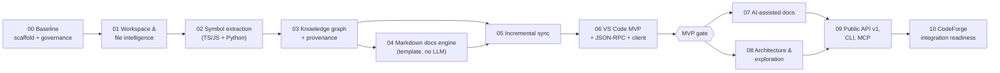

# Implementation Roadmap

> Status: Baseline v0.1 · Phases 00–10 · **MVP = Phases 00–06**
> Every phase is independently verifiable. Phase N exits only when its exit criteria hold **and** every CRITICAL/HIGH invariant with `phase ≤ N` passes on Windows and Linux (DOMAIN_INVARIANTS §1).
> Each phase produces a `governance/phase_NN_checklist.yaml` and a `docs/phases/PHASE_NN_SIGNOFF.md`, which follow the CodeForge-style "honest sign-off" format: evidence, deferred items, self-review.

**Branch workflow** (agreed with the project owner after Phase 00):
- `main` contains only **closed** phases.
- Each phase is developed on a branch `phase-NN`, which starts from `main`.
- A phase closes in this order: the checklist is complete, `governance/phase.yaml` is bumped, CI is green on the full matrix, the owner approves, and then `main` is **fast-forwarded** to the closing commit (never force-pushed) and `phase-NN` is deleted.
- The next phase branch starts from the new `main`.
- At most two branches exist at any time: `main` and the phase in progress.

## Overview

---

## Phase 00: Architecture and Domain Baseline

**Scope.** Make the architecture executable. **No feature implementation** (NFR-044).

| Item | Content |
|---|---|
| Dependencies | This planning package |
| Deliverables | 1. Repository scaffold per SYSTEM_ARCHITECTURE §5: root `package.json` (npm workspaces, `engines.node ">=24 <27"`, `private`, `license: "UNLICENSED"`), `.npmrc` (`save-exact`, `engine-strict`), `tsconfig.base.json` (strict, NodeNext, `noUncheckedIndexedAccess`, `exactOptionalPropertyTypes`, `verbatimModuleSyntax`), solution `tsconfig.json`, `vitest.config.ts`. 2. Packages `protocol`, `core`, `adapters`, `runtime` with empty `src/index.ts`. `core` gets the context folders from BOUNDED_CONTEXTS §6, each with a `public.ts`. **No** `client`, `mcp` or `vscode-extension` packages yet. 3. `shared-kernel`: branded ID types, `CanonicalPath` type, `SourceRange`, `ContentHash`, `Result`, `DomainError`, plus `Clock`/`Hasher`/`CancellationSignal` interfaces. Types only, with unit tests for the brand constructors. 4. **Empty port interfaces** (type declarations only) for every port in SYSTEM_ARCHITECTURE §7 that Phase 01 needs: `FileSystem`, `ConfigSource`, `WorkspaceRepository`, `RevisionStore`, `RevisionWriter`, `LeaseManager`, `JobRepository`, `ChangeSource`. 5. ESLint 9 flat config with the boundary guards. `.dependency-cruiser.cjs` per ARCHITECTURE_FITNESS §4 plus violation fixtures. 6. `governance/`: moved from `docs/planning/governance/` (leave a README pointer), plus `fitness.yaml` and `shared-kernel.allowlist`. 7. `scripts/check-governance.mjs` (schema validation, test presence for `phase ≤ CIE_PHASE`, ID no-removal against the base branch, md↔yaml parity). 8. CI workflows: `governance`, `dependency-direction`, `test` (matrix: windows-latest and ubuntu-latest × Node 24 and 26). 9. `tests/fitness/*` per ARCHITECTURE_FITNESS §5. 10. Exact dependency versions chosen after `npm view` checks and recorded in the Phase 00 checklist (typescript, vitest, eslint 9.x, typescript-eslint, dependency-cruiser, ajv, js-yaml, fast-check). |
| Acceptance criteria | `npm ci && npm run typecheck && npm run lint && npm run depcruise && npm test && node scripts/check-governance.mjs` pass on both OSes and both Node versions. Each FF-DEP/FF-BND rule fires on its violation fixture. `check-governance` fails on: an invalid YAML fixture; a CRITICAL invariant with `phase: 0` and no test (synthetic fixture); and a removed ID. |
| Tests | `tests/fitness/*`; shared-kernel unit tests; governance script tests |
| Risks | Over-building the core (mitigated by the "types and empty ports only" rule); depcruise back-reference support (ARCHITECTURE_FITNESS §4 note); ESLint 9 vs 10 (OQ-08) |
| Exit criteria | All of the above green, plus a decision on ArchUnitTS adoption (OQ-10) recorded, plus sign-off |
| **Excluded** | Any adapter implementation, SQLite, tree-sitter, file walking, CLI, JSON-RPC, extension package, benchmarks harness |

## Phase 01: Workspace and File Intelligence

**Scope.** Index a workspace's **files and structure** into an immutable published revision, with the full revision, lease and recovery machinery. A dev CLI (`cie dev index|status|export`) supports dogfooding.

| Item | Content |
|---|---|
| Dependencies | Phase 00 |
| Entry spike **S1** | `better-sqlite3` (latest 13.x, exact pin) loads, opens a WAL DB, and creates an FTS5 table on Node 24 and 26, win32-x64 and linux-x64 (A-02, A-03). Results go into ADR-0004 and ADR-0008. If it fails, apply the ADR-0008 fallback. |
| Deliverables | `workspace` domain: PathCanonicalizer, IgnoreEvaluator (`.gitignore` semantics, defaults, `cie.config.json` allow-list), ManifestBuilder. `synchronization` domain: IndexRevision, IndexJob, PublishPolicy, FreshnessEvaluator, RecoveryService. Adapters: `fs` (GuardedFileSystem: realpath confinement, write confinement), `sqlite` (`index.db` and `state.db` open checks, `meta.workspace_id`, migrations framework, revision tables, lease, file and node tables for file, dir and package nodes, visibility-filter query builder), `config` (workspace allow-list + user config dir; SEC-005). Runtime: composition root, `llm-none` default, dev CLI. Benchmarks: harness skeleton, environment capture, `fixtures.json` with pinned SHAs (Zod, Requests, CodeForge-v2; the other tiers are listed but not run). |
| Acceptance criteria | `cie dev index` on `fixtures/*`, Zod, Requests and CodeForge-v2 (using a `--state-dir` outside the fixture) publishes revision 1. `cie dev export` is byte-identical across two runs and across Windows and Linux (WS-004). Killing the process at any stage, then restarting, yields a valid published revision (SN-005). A concurrent second writer gets `CIE_BUSY` (SN-004). A corrupted `index.db` is quarantined and rebuilt (NFR-021). |
| Tests (invariants) | WS-001..004, SN-001, SN-002, SN-003, SN-004, SN-005, SN-007, SEC-002, SEC-005, AI-004; FF-DAT-001/002/004/005; adversarial paths and config; crash injection |
| Risks | Windows path edge cases (R-08); `.gitignore` semantic fidelity (use a well-tested matcher library; selection recorded in the checklist); lease expiry tuning |
| Exit criteria | All Phase 01 CRITICAL/HIGH invariants green on both OSes; B-01/B-02/B-10/B-11 recorded for the small tier (no thresholds); sign-off |
| **Excluded** | Symbol extraction, the graph beyond file/dir/package nodes, watcher, incremental indexing, JSON-RPC server, LLM |

## Phase 02: Multi-language Symbol Extraction

| Item | Content |
|---|---|
| Scope | Symbols, spans, fingerprints and imports for TS/TSX/JS (tree-sitter + TS module resolution) and Python (tree-sitter + import heuristics). Capability profiles. |
| Dependencies | Phase 01 |
| Entry spike **S2** | web-tree-sitter (exact pin) loads the TS, TSX and Python grammar `.wasm` (A-01); JS grammar strategy (E-05); results go into ADR-0010 |
| Deliverables | `code-intelligence` domain: SymbolIdentity, CapabilityProfile, FileExtraction factory (SY-006 checks). Ports `FileExtractor` and `ProjectResolver`. Adapters `treesitter` (CIE-owned queries, grammar lock manifest), `lang-ts` (Program per tsconfig, import resolution only in this phase; plugins disabled), `lang-python` (import resolver). Node projection for module, symbol, external and unresolved nodes, plus `contains`, `defines`, `exports`, `imports`, `imports_symbol` edges. Golden fixtures. `symbols.search` via FTS in the dev CLI. |
| Acceptance criteria | Golden equality on all fixtures; symbol precision and recall reported vs the TS compiler for TS fixtures and vs hand-verified sets for Python; the capability matrix is exposed via `cie dev status`. |
| Tests | SY-001, SY-002, SY-003, SY-005, SY-006, KG-001; FF-DAT-003, FF-DAT-006; adversarial (parse errors, huge files, a tsconfig plugin, A-06) |
| Risks | ABI mismatch (R-02); TS memory on large projects (R-05); Python heuristics quality |
| Exit criteria | Invariants green; golden fixtures reviewed; sign-off |
| **Excluded** | References, calls, type relations (Phase 03); incremental (Phase 05); Dart |

## Phase 03: Knowledge Graph and Provenance

| Item | Content |
|---|---|
| Scope | References, calls and type-relation edges (TS L3, Python L2); claims, evidence, status machine; RelationType registry; bounded traversal read models; impact query |
| Dependencies | Phase 02 |
| Deliverables | `knowledge` domain: KnowledgeClaim, ClaimVerifier (capability token), StalenessEvaluator (used fully in Phase 05), RelationType registry. `GraphReadModel` with depth and limit bounds. `lang-ts` references, calls, `extends`/`implements`. `lang-python` heuristic references and calls (inferred). Dev CLI queries: `deps`, `refs`, `impact`, `neighbors`. `EXPLAIN QUERY PLAN` tests. |
| Acceptance criteria | Reference and call precision/recall for TS vs scip-typescript (generated offline) is reported; Python is reported vs scip-python. Every query is bounded and plan-tested. Graph export validates. |
| Tests | KG-002, KG-003, KG-004, PV-001, PV-002, PV-003; FF-BND-005, FF-PRF-004; type-level tests |
| Risks | Edge volume and DB size (R-06); call-graph cost |
| Exit criteria | Invariants green; quality metrics recorded (no thresholds); sign-off |
| **Excluded** | Architecture components (Phase 08), flows (Phase 08), LLM claims (Phase 07) |

## Phase 04: Markdown Documentation Engine (template-based, no LLM)

| Item | Content |
|---|---|
| Scope | Page model, parser, ownership markers, slots, hash-guarded writes, conflicts, link resolution, user-asserted relations from front matter, template generators, drafts in `.cie/wiki`, opt-in publish |
| Dependencies | Phase 03 |
| Deliverables | `documentation` domain: WikiPage, SectionWriteGuard, LinkResolver, page registry. Adapters: `markdown` (parser), PageStore (atomic writes, locking). Generators for concept, module and component code-location tables, symbol inventories and dependency lists. Dev CLI: `wiki validate`, `docs generate`, `docs publish`, `wiki adopt`. CIE's own `docs/wiki/` seeded for dogfooding. |
| Acceptance criteria | `wiki-basic` golden passes; property tests for byte preservation pass; conflict flow works end to end; `wiki validate` reports all seeded broken, malformed and duplicate cases. |
| Tests | DOC-001, DOC-002, DOC-003, DOC-004, DOC-005, DOC-007, DOC-008 (report), PV-005; adversarial markers (T10) |
| Risks | Markdown parser edge cases (CRLF, BOM, front-matter variants) |
| Exit criteria | Invariants green; sign-off |
| **Excluded** | LLM prose; staleness propagation (Phase 05); Webview rendering |

## Phase 05: Incremental Synchronization

| Item | Content |
|---|---|
| Scope | Change log (seq), hints (watcher + explicit), reconciliation scanner, incremental pipeline (KNOWLEDGE_GRAPH_DESIGN §7), lineage, staleness propagation, AnchorResolver, GC and retention |
| Dependencies | Phases 03 and 04 |
| Deliverables | `synchronization` application: IndexScheduler (debounce), IncrementalIndexService, StalenessPropagation. `code-intelligence` domain: SymbolMatcher, AnchorResolver. Adapter `watch` (A-07). `BuilderProgram` in `lang-ts`. Optional worker-thread extraction (only if measured necessary). `drift-scripts` fixtures. |
| Acceptance criteria | No-op incremental parses 0 files; a single-file edit parses exactly the changed file plus its declared dependents (FF-PRF-001 counters); drift scenarios A–G resolve as specified (DOCUMENTATION_MODEL §11); freshness transitions correct under a simulated watcher drop; **first performance baselines** recorded on the small tier and CodeForge-v2. |
| Tests | SY-004, PV-004, SN-008, DOC-006; FF-PRF-001 (blocking), FF-PRF-002/006 (advisory) |
| Risks | Lineage false matches (R-09); watcher reliability on Windows (R-07); `tsconfig` change cascades |
| Exit criteria | Invariants green; baselines agreed (BENCHMARK_STRATEGY §6 steps 1–3); sign-off |
| **Excluded** | Cross-workspace knowledge; branch-aware indexes |

## Phase 06: VS Code Extension MVP (+ JSON-RPC server + `@cie/client`)

| Item | Content |
|---|---|
| Scope | JSON-RPC stdio server (query plus control profiles, the method subset marked 06 in PUBLIC_API_CONTRACT §6), `@cie/client`, `@cie/protocol` v1-pre, extension (supervisor, Wiki Explorer, QuickPick search, Wiki panel with React Webview and bottom sheet, hover, navigation, status bar, conflict UI) |
| Dependencies | Phase 05 |
| Deliverables | Packages `client` and `vscode-extension`; `runtime/jsonrpc`; protocol mapping; contract suite (in-process + JSON-RPC); extension integration tests; packaging option A (VSIX + npm runtime); an accessibility audit task (automated axe checks plus a manual keyboard and screen-reader pass, documented) |
| Acceptance criteria | **MVP scenario** (PROJECT_VISION §6) demonstrated on the small tier and CodeForge-v2, with `llm-none`, on Windows and Linux. Navigation passes drift scenarios A–D and F live. Extension activation does not happen in non-CIE workspaces. |
| Tests | SN-006, SEC-004, SEC-006, API-002, API-003; FF-BND-004, FF-BND-008; FF-PRF-003/007 (regression vs baseline); contract suite |
| Risks | System Node availability (R-01); Webview performance on large pages; accessibility gaps (R-11) |
| Exit criteria | **MVP gate**: all CRITICAL/HIGH invariants with phase ≤ 6 green; MVP benchmark gate (BENCHMARK_STRATEGY §7, small tier + CodeForge-v2 only); sign-off |
| **Excluded** | LLM features, Architecture Explorer, flows UI, MCP, public v1 freeze, bundled-runtime VSIX (stretch) |

**MVP line.** At the end of Phase 06, CIE is useful with no LLM: a navigable, synchronized wiki with verified structure, user-curated concepts and exact navigation.

## Phase 07: AI-Assisted Documentation

| Item | Content |
|---|---|
| Scope | `LlmProvider` port + `llm-ollama` + guarded `llm-openai-compatible`; consent store (user config); SecretRedactor; PromptBuilder; InferenceIntake; LLM summary sections; inferred `implements_concept` / `related_to` proposals; AI-proposed concepts (adoptable by users); response cache in `state.db` |
| Dependencies | MVP |
| Acceptance criteria | Phase 07 quality protocol executed (BENCHMARK_STRATEGY §5.3) and results recorded; prompt-injection suite passes; with the LLM off, behavior is unchanged (AI-004) |
| Tests | AI-001, AI-002, AI-003, SEC-001, SEC-003, PV-006 (report); adversarial prompt-injection and secrets |
| Risks | Local model quality (R-10); prompt-injection novelty |
| Exit criteria | Invariants green; sign-off with a quality report |
| **Excluded** | Embeddings and semantic search ([DEF]), agentic LLM tool use (never) |

## Phase 08: Architecture and Knowledge Exploration

| Item | Content |
|---|---|
| Scope | Architecture model (components from packages and folders, user-declared layers and rules in `cie.config.json` [non-sensitive] or wiki front matter), `depends_on`/`violates`, `architecture.get`, `flows.trace`, Architecture Explorer TreeView, Webview graph view (bounded neighborhoods), optional SCIP import (ADR-0011) |
| Dependencies | MVP (Phase 07 is not required) |
| Acceptance criteria | Layer violations on a fixture with seeded violations are 100% detected (deterministic). Flow traces report completeness correctly on `js-mixed`. Graph view renders bounded neighborhoods within the query caps. |
| Tests | Architecture rule tests; flow completeness tests; SCIP reconciliation tests (if included) |
| Risks | Graph visualization performance; choice of a graph rendering library (evaluated in this phase) |
| Exit criteria | Sign-off |
| **Excluded** | Global whole-repo graph rendering |

## Phase 09: Public API v1 and CLI

| Item | Content |
|---|---|
| Scope | Freeze `@cie/protocol` v1.0 (API-001 snapshot blocking), the remaining methods, a public CLI (`cie init/index/status/query/export/serve/mcp`), the `@cie/mcp` server (query profile only, MCP spec pinned at entry, E-09/E-10), and the contract suite over MCP |
| Dependencies | Phases 07 and 08 (method completeness) |
| Acceptance criteria | Contract suite green over all three transports; API docs generated from the protocol package; MCP server works with at least one reference MCP client |
| Tests | API-001, SEC-004 (MCP profile), FF-BND-004, FF-BND-006 |
| Risks | MCP spec churn (R-12) |
| Exit criteria | v1.0 tag criteria met; license decision **required** before any publication (ADR-0013) |
| **Excluded** | HTTP transport ([DEF]) |

## Phase 10: CodeForge Integration Readiness

| Item | Content |
|---|---|
| Scope | Everything CodeForge needs **from CIE's side**: the contract test kit for consumers, a documented mapping (CODEFORGE_INTEGRATION §4), a `@cie/client` compatibility matrix (Node ≥20 support verified, OQ-11), follower-mode hardening, and a reference adapter **example** in CIE's `examples/` that uses only public APIs and is not a CodeForge dependency |
| Dependencies | Phase 09 |
| Acceptance criteria | The example adapter produces `ContextSignals`-shaped output from CIE on the CodeForge-v2 fixture using only `@cie/client`. Flag-off parity is demonstrated (no CIE ⇒ identical output). FF-DEP-004 is still green. |
| Tests | Consumer contract kit; follower-mode concurrency tests |
| Risks | CodeForge-side decisions (CFQ-1..5) |
| Exit criteria | Readiness sign-off; handover note to the CodeForge maintainers |
| **Excluded** | Any change to the CodeForge repository (owned and decided by CodeForge) |

---

## What "ready for Phase 00" means

These hold now:
- The architecture, contexts, ports, invariants, fitness rules and Phase 00/01 deliverables are specified.

These are **not yet true**, and they are tracked in RISKS_AND_OPEN_QUESTIONS:
- Spikes S1 and S2 have not been run. ADR-0004, ADR-0008 and ADR-0010 are conditional on them.
- Exact dependency versions are not pinned (a Phase 00 task).
- The license is undecided. It does not block Phases 00–08.
