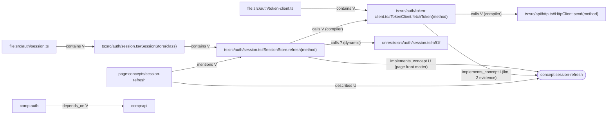

# Knowledge Graph Design

> Status: Baseline v0.1 · Related: ADR-0008, ADR-0014, ADR-0015, KG-*, PV-*, SN-* invariants

## 1. Design goals

1. **One graph, two kinds of claims.**
   - *Structural edges* are high-volume and deterministic. Their evidence is **intrinsic**: producer, path, range and file hash are stored inline.
   - *Semantic claims* are low-volume and come from LLMs, heuristics or users. Their evidence is **explicit**: evidence rows.
2. **Revision-scoped everything**, using validity intervals (ADR-0015).
3. **Bounded queries only** (KG-004, FF-PRF-004). No query loads the whole graph.
4. **The SQLite index is rebuildable** from source plus repo Markdown plus the `state.db` LLM cache (NFR-020).

## 2. Node types

| Kind | ID scheme (`NodeId`) | Structural? | Backing record | Created by |
|---|---|---|---|---|
| `workspace` | `ws:` | yes | Workspace | init |
| `directory` | `dir:<path>` | yes | manifest | enumeration |
| `file` | `file:<path>` | yes | FileRecord | enumeration |
| `package` | `pkg:npm:<name>` / `pkg:py:<name>` (workspace-local) | yes | package.json / pyproject / `__init__` root | Phase 01 |
| `module` | `mod:<lang>:<path>` | yes | FileRecord (a module is the language view of a file) | Phase 02 |
| `symbol` | `SymbolId` (ADR-0014) | yes | SymbolRecord | Phase 02 |
| `external` | `ext:npm:<name>` / `ext:pypi:<name>` | yes | import resolution | Phase 02 |
| `unresolved` | `unres:<lang>:<path>#<siteHash>` | yes | the unresolved site (SY-006) | Phase 02 |
| `concept` | `concept:<slug>` | no | Concept aggregate (Markdown or AI proposal) | Phase 04 / 07 |
| `component` | `comp:<slug>` | no | Architecture model (derived from packages, or user-declared) | Phase 08 |
| `layer` | `layer:<slug>` | no | User-declared architecture rules | Phase 08 |
| `page` | `PageId` (front matter) | no | WikiPage | Phase 04 |

## 3. Relation types (registry, KG-002)

**Status legend:** V = verified, I = inferred, U = user_asserted, ? = unknown.

| Type | Signature (from → to) | Semantics | Allowed statuses | Producer kinds |
|---|---|---|---|---|
| `contains` | dir→dir, dir→file, file→symbol, symbol→symbol, package→dir | Lexical or physical containment | V | filesystem, ast |
| `defines` | module→symbol | Module-level definition | V | ast, compiler |
| `exports` | module→symbol | Symbol is exported from the module (incl. re-exports, with `via`) | V, I | compiler (V), ast/heuristic (I) |
| `imports` | module→module, module→external, module→unresolved | Static import dependency (`isTypeOnly`, `isDynamic` attrs) | V, I, ? | compiler (V), heuristic (I), — (?) |
| `imports_symbol` | module→symbol | Named import binding | V, I | compiler, heuristic |
| `references` | symbol→symbol | Identifier occurrence in `from`'s body resolves to `to` (occurrence ranges as attributes) | V, I | compiler, scip, heuristic |
| `calls` | symbol→symbol, symbol→unresolved | Static call expression targets `to` | V, I, ? | compiler, scip, heuristic |
| `may_dispatch_to` | symbol(method)→symbol(method) | Virtual or interface call may reach an implementer | I | compiler + analysis, heuristic |
| `extends` | symbol→symbol | Class or interface inheritance | V, I | compiler, heuristic |
| `implements` | symbol→symbol | Class implements interface | V | compiler |
| `references_type` | symbol→symbol | Type annotation reference | V, I | compiler, heuristic |
| `injects` | symbol→symbol | DI wiring (constructor injection etc.) | I | heuristic:di-* |
| `depends_on` | component→component, package→package | Aggregated dependency (derived from `imports`) | V (derived from V edges only) / I | derivation |
| `belongs_to` | file/dir/package→component, component→layer | Architecture membership | V (rule-based from config), U | architecture rules, user |
| `violates` | component→component | A `depends_on` edge breaks a declared layer rule | V | rule evaluation |
| `describes` | page→concept / page→symbol / page→component | The page is about the target | U (front matter), I | markdown, llm |
| `mentions` | page→any | The page links to the target (from link resolution) | V | link resolver |
| `implements_concept` | symbol/module/component→concept | The code realizes the concept | U, I, ? | user, llm |
| `related_to` | concept→concept | Generic association | U, I | user, llm |
| `part_of` | concept→concept | Concept hierarchy | U, I | user, llm |
| `flow_step` | symbol→symbol | Ordered step in a declared or traced execution flow (attrs: `flowId`, `order`) | V (from V calls), I | flow tracer, user |
| `lineage` | symbol→symbol | Identity change: `moved` / `renamed` (SY-004) | V | SymbolMatcher |

**Distinguishing the four relationship classes** (brief §7):

| Class | How it is represented |
|---|---|
| Verified structural | `edge.status = 'verified'`, `precision = 'exact'`, intrinsic evidence from a deterministic producer |
| Inferred semantic | `status = 'inferred'`; a claim with explicit evidence rows (LLM response artifact, heuristic producer) |
| User-authored | `status = 'user_asserted'`, `origin = page:<PageId>#frontmatter` |
| Unknown / unresolved | `status = 'unknown'` and/or an edge to an `unresolved` node, or a claim answering `insufficient_evidence` |

## 4. Stable identifiers

| ID | Derivation |
|---|---|
| Structural node IDs | Derived from structural identity (path, `SymbolId`), so they are stable across rebuilds (KG-003) |
| Concept IDs | Slug from the front-matter `cie.id` / `concept` key, which is user-controlled and stable. AI-proposed concepts get `concept:ai-<hash(title)>` until a user adopts them. |
| Edge identity | `(type, from, to, siteKey)`, where `siteKey` is the occurrence range hash for occurrence-based types (`references`, `calls`) and empty otherwise |
| Claim IDs | `claim:<hash(subject, predicate, object, origin)>`. Deterministic, so re-intake of the same LLM output does not duplicate claims. |
| Evidence IDs | `ev:<hash(kind, producer, locator, contentHash)>` |

## 5. SQL schema sketch (`index.db`)

This is a specification for Phase 01–03. Column types are SQLite affinities. Every table marked (R) is revision-scoped with `valid_from_seq INTEGER NOT NULL, valid_to_seq INTEGER NULL`.

```sql
CREATE TABLE meta (key TEXT PRIMARY KEY, value TEXT NOT NULL);  -- workspace_id, schema_version, producer versions

CREATE TABLE workspace_head (           -- single row; ADR-0015
  id INTEGER PRIMARY KEY CHECK (id = 1),
  current_seq INTEGER NOT NULL,
  watermark INTEGER NOT NULL
);
CREATE TABLE index_revision (
  seq INTEGER PRIMARY KEY, base_seq INTEGER NOT NULL,
  status TEXT NOT NULL CHECK (status IN ('building','validating','published','superseded','abandoned')),
  watermark INTEGER NOT NULL, manifest_hash TEXT, job_id TEXT NOT NULL,
  created_at TEXT NOT NULL, published_at TEXT
);
CREATE TABLE index_lease (id INTEGER PRIMARY KEY CHECK (id = 1), holder TEXT, expires_at TEXT);

-- Stable identity keys: NOT revision-scoped, append-only, garbage-collected with the last referencing version.
-- Versioned rows reference these keys, so a new version of a node (e.g. a shifted range) never
-- invalidates edges that point at it (SN-007 + KG-001 together; see the contradiction log C-02).
CREATE TABLE file_key (key INTEGER PRIMARY KEY, path TEXT NOT NULL UNIQUE);
CREATE TABLE node_key (key INTEGER PRIMARY KEY, node_id TEXT NOT NULL UNIQUE, kind TEXT NOT NULL);

CREATE TABLE file (                     -- (R) one row per file *version*
  rowid INTEGER PRIMARY KEY, file_key INTEGER NOT NULL REFERENCES file_key(key),
  hash TEXT NOT NULL, size INTEGER NOT NULL, line_count INTEGER,
  lang TEXT, status TEXT NOT NULL,      -- indexed | skipped:<reason>
  valid_from_seq INTEGER NOT NULL, valid_to_seq INTEGER
);
CREATE INDEX file_key_vis ON file(file_key, valid_to_seq);

CREATE TABLE node (                     -- (R) one row per node *version*, all node kinds
  rowid INTEGER PRIMARY KEY, node_key INTEGER NOT NULL REFERENCES node_key(key), kind TEXT NOT NULL,
  name TEXT, qualified_name TEXT, file_key INTEGER REFERENCES file_key(key),
  start_line INTEGER, start_col INTEGER, end_line INTEGER, end_col INTEGER,
  span_hash TEXT, body_fingerprint TEXT, exported INTEGER, symbol_kind TEXT,
  producer TEXT NOT NULL, fidelity TEXT NOT NULL, attrs TEXT,  -- JSON (small)
  valid_from_seq INTEGER NOT NULL, valid_to_seq INTEGER
);
CREATE INDEX node_key_vis  ON node(node_key, valid_to_seq);
CREATE INDEX node_file_vis ON node(file_key, valid_to_seq);
CREATE UNIQUE INDEX node_head_unique ON node(node_key) WHERE valid_to_seq IS NULL;  -- SY-002 (head)

CREATE TABLE relation_type (name TEXT PRIMARY KEY, from_kinds TEXT NOT NULL, to_kinds TEXT NOT NULL,
  allowed_status TEXT NOT NULL);       -- seeded from the §3 registry (KG-002)

CREATE TABLE edge (                     -- (R) structural + semantic relations
  rowid INTEGER PRIMARY KEY,
  type TEXT NOT NULL REFERENCES relation_type(name),
  from_key INTEGER NOT NULL REFERENCES node_key(key),   -- FK guarantees identity exists;
  to_key   INTEGER NOT NULL REFERENCES node_key(key),   -- RevisionValidator guarantees visibility at seq (KG-001)
  site_key TEXT NOT NULL DEFAULT '',
  status TEXT NOT NULL CHECK (status IN ('verified','inferred','user_asserted','unknown')),
  freshness TEXT NOT NULL DEFAULT 'current' CHECK (freshness IN ('current','stale')),
  precision TEXT CHECK (precision IN ('exact','heuristic')),
  -- intrinsic evidence (structural)
  ev_kind TEXT, ev_producer TEXT, ev_file_key INTEGER REFERENCES file_key(key),
  ev_start_line INTEGER, ev_start_col INTEGER, ev_end_line INTEGER, ev_end_col INTEGER, ev_content_hash TEXT,
  claim_id TEXT,                        -- set for semantic edges (explicit evidence in claim_evidence)
  attrs TEXT,
  valid_from_seq INTEGER NOT NULL, valid_to_seq INTEGER
);
CREATE INDEX edge_out ON edge(from_key, type, valid_to_seq);
CREATE INDEX edge_in  ON edge(to_key,   type, valid_to_seq);

CREATE TABLE claim (                    -- (R) semantic claims (non-edge too: attribute claims)
  rowid INTEGER PRIMARY KEY, claim_id TEXT NOT NULL, subject_key INTEGER NOT NULL REFERENCES node_key(key),
  predicate TEXT NOT NULL, object_key INTEGER REFERENCES node_key(key), object_value TEXT,
  status TEXT NOT NULL, freshness TEXT NOT NULL, origin TEXT NOT NULL,  -- llm:<model> | heuristic:<id> | page:<PageId>
  author TEXT,                          -- required when status = user_asserted (PV-005)
  valid_from_seq INTEGER NOT NULL, valid_to_seq INTEGER
);
CREATE TABLE evidence (                 -- (R) explicit evidence (PV-003)
  rowid INTEGER PRIMARY KEY, evidence_id TEXT NOT NULL,
  kind TEXT NOT NULL CHECK (kind IN ('filesystem','ast','compiler','scip','lsp','heuristic','llm','user')),
  producer TEXT NOT NULL, seq INTEGER NOT NULL, content_hash TEXT NOT NULL,
  file_key INTEGER REFERENCES file_key(key), start_line INTEGER, start_col INTEGER, end_line INTEGER, end_col INTEGER,
  artifact TEXT,                        -- e.g. llm:response:<hash>, scip:<file>#<occ>
  CHECK (file_key IS NOT NULL OR artifact IS NOT NULL),
  -- content_hash pins the file *version* the evidence was observed in (historical evidence allowed; PV-004 decides freshness)
  valid_from_seq INTEGER NOT NULL, valid_to_seq INTEGER
);
CREATE TABLE claim_evidence (            -- (R) links by stable IDs, so a new claim version keeps its evidence links
  claim_id TEXT NOT NULL, evidence_id TEXT NOT NULL,
  valid_from_seq INTEGER NOT NULL, valid_to_seq INTEGER, PRIMARY KEY (claim_id, evidence_id, valid_from_seq));
CREATE TABLE claim_transition (claim_id TEXT NOT NULL, seq INTEGER NOT NULL, from_status TEXT, to_status TEXT NOT NULL,
  actor TEXT NOT NULL, reason TEXT NOT NULL);          -- PV-002 audit (append-only)

CREATE TABLE lineage (from_symbol TEXT NOT NULL, to_symbol TEXT, kind TEXT NOT NULL
  CHECK (kind IN ('moved','renamed','deleted')), at_seq INTEGER NOT NULL);

CREATE VIRTUAL TABLE search_fts USING fts5(           -- ADR-0008 (A-03); keyed by stable node_key
  node_key UNINDEXED, name, qualified_name, path, doc, tokenize = 'unicode61 remove_diacritics 2');
-- FTS is head-only: rebuilt for changed nodes at publish time inside the publish transaction.

CREATE TABLE page (...);  CREATE TABLE section (...);  CREATE TABLE link (...);   -- see DOCUMENTATION_MODEL §9
```

**Visibility filter.** Every read applies `valid_from_seq <= :seq AND (valid_to_seq IS NULL OR valid_to_seq > :seq)`. Repository code generates the predicate, and FF-BND-003 forbids raw SQL elsewhere.

**FTS and revisions.** FTS indexes **head only**. Queries pinned to an older seq re-check visibility by joining back to `node` with the visibility filter, and may miss names that changed since. This is accepted for search. [Proposal]

## 6. Workspace and revision scoping

- **Workspace scoping is physical.** One `index.db` per workspace, checked against `meta.workspace_id` (WS-003). No `workspace_id` column is needed.
- **Revision scoping** uses validity intervals (ADR-0015). Garbage collection keeps `retention.keepRevisions` revisions (default [Proposal]: 3), plus any revision pinned by an open cursor.

## 7. Incremental graph update algorithm (Phase 05)

Input: head `H`, ChangeSet `C` (paths with hints).

1. **Confirm the changes.** Rehash the candidate paths. `Changed` = {hash differs}, `Added`, `Removed`. Paths whose hash is unchanged are dropped (hints are not truth).
2. **Begin staging revision** `N = H + 1` under the lease.
3. **Files.** Close the rows for removed and changed files (`valid_to_seq = N`), and insert new rows for added and changed files.
4. **Extract.** Run `FileExtractor` on Changed ∪ Added.
5. **Match symbols** (SY-004). For each changed file, compare the old symbols (visible at `H`) with the new extraction:
   - The same `SymbolId` with the same `spanHash` is `unchanged`. If its range shifted, a **new node version** is written (old row closed at N, new row from N, same `node_key`). Visible rows are never updated in place (SN-007), and edges keyed by `node_key` stay valid.
   - The same `SymbolId` with a different `spanHash` is `modified`.
   - An old ID that is missing while a new ID has an equal `bodyFingerprint`, the same kind and the same container is `renamed` (if in the same file) or `moved` (if in another changed or added file). This step is global across the ChangeSet.
   - Anything else is `deleted` or new.
   - Lineage rows are written for moved, renamed and deleted symbols.
6. **Affected set.**
   - Dependents come from `edge_in` on `imports` and `imports_symbol` of the changed modules, plus any `ProjectResolver.affectedFiles`.
   - Edges *originating* in Changed ∪ Affected are closed and re-resolved. Edges *targeting* deleted nodes are closed (KG-001), and their sources are scheduled for re-resolution.
7. **Resolve.** Run `ProjectResolver.resolve` on the affected set. TS uses `BuilderProgram`.
8. **Staleness** (PV-004, DOC-006). For claims and sections whose evidence references changed files or deleted nodes, set `freshness = 'stale'` as a new row version in N.
9. **Derived aggregates.** Recompute `depends_on` and `violates` only for the components that touch changed modules.
10. **Validate and publish.** Run RevisionValidator on the delta, then CAS-publish with `watermark = max(C.seq)` (SN-001/002).

**Fallback.** If the affected set exceeds a fraction of the repo (a [Proposal] config value calibrated by benchmarks), or a `tsconfig`/`package.json` changed, the job escalates to a project-scoped full re-resolution, still incremental at the file-extraction level.

## 8. Retrieval design: bounded query plans

Each query below takes `seq` (default head), `limit` (≤ server cap) and `signal`. Every recursive traversal carries an explicit depth bound and a row limit (KG-004). Cycle safety comes from `UNION` (not `UNION ALL`) on `(node, depth)`, plus a visited check in the application for path outputs.

### 8.1 Symbol search
- FTS5 `MATCH` on `name`/`qualified_name` (prefix and token), filtered by `kind`, `lang` and `path` glob.
- Join `node` with the visibility filter. Rank is FTS rank plus an exact-name bonus plus a bonus for exported symbols. Ordering is deterministic, with ties broken by `node_id`.
- Fallback: `name LIKE` on an indexed `name` column, for very short queries.

### 8.2 Concept search
FTS over concept titles, aliases and page text. Returns concepts with their `describes` pages and their `implements_concept` symbols (top-k, status-labeled).

### 8.3 Dependency query (outgoing / incoming, file or symbol)
```sql
WITH RECURSIVE dep(node_key, depth) AS (
  SELECT :startKey, 0
  UNION
  SELECT e.to_key, d.depth + 1 FROM dep d
  JOIN edge e ON e.from_key = d.node_key
   AND e.type IN ('imports','imports_symbol')      -- or calls / references_type, per request
   AND e.valid_from_seq <= :seq AND (e.valid_to_seq IS NULL OR e.valid_to_seq > :seq)
  WHERE d.depth < :maxDepth
)
SELECT * FROM dep LIMIT :limit + 1;                -- +1 to detect truncation
```
Incoming dependencies use `edge_in` (`to_key = d.node_key`). The final projection joins `node` with the visibility filter at `:seq`, so only node versions visible at that revision are returned.

### 8.4 Reference query
A single hop on `edge_in` with `type = 'references'` (plus `calls`), returning occurrence ranges from `attrs` and `ev_*` columns. Paginated by `(file path, start_line)`.

### 8.5 Architecture query
Reads `component` nodes plus `depends_on` and `violates` edges. These are aggregated and precomputed at publish (§7 step 9), so this is O(components) and never touches symbol edges.

### 8.6 Affected-symbol (impact) query
Input: changed paths or symbol IDs. Reverse closure over `references`, `calls`, `imports_symbol`, `extends`, `implements` and `references_type` using `edge_in`, up to `maxDepth` (default [Proposal]: 3). Each result reports:
- its depth;
- the path of edge types;
- the **weakest** status along the path, so an inferred edge anywhere makes the impact entry inferred.

### 8.7 Execution-flow query
Input: an entry symbol. It returns a DAG of up to `maxDepth` and `limit` nodes, built by traversing `calls` (and optionally `may_dispatch_to`) forward. Each step carries:
- the edge status;
- the call-site anchor;
- ordering by call-site position within the caller.

Flow-level summary: `{verifiedSteps, inferredSteps, unresolvedCalls}`. If `unresolvedCalls > 0`, the response states `completeness: 'partial'`. Flows are therefore evidence-qualified and never presented as complete when they are not (brief O3, "where sufficient evidence exists").

### 8.8 Neighbors (generic exploration)
One hop in or out over the requested types, grouped by type and capped per type (`perTypeLimit`). This feeds the UI relationship explorer.

## 9. Graph consistency checks (RevisionValidator)

| Check | Invariant | Query sketch |
|---|---|---|
| Dangling endpoints | KG-001 | Edges visible at N whose `from` or `to` is not visible at N must be 0 |
| Type signature | KG-002 | Join `relation_type`; node kinds ∈ allowed kinds |
| Structural backing | KG-003 | Symbol nodes without a visible file must be 0 |
| Duplicate IDs | SY-002 | `GROUP BY node_id HAVING count > 1` over visible rows |
| Span bounds | SY-003 | `end_line` ≤ file line count (stored per file) |
| Verified evidence | PV-001 | Verified claims without qualifying evidence must be 0 |
| Path membership | WS-001 | Structural records: `node.file_key` and `edge.ev_file_key` have a file version visible at N. Explicit evidence: `file_key` exists (historical versions are allowed; freshness is set by PV-004). |

## 10. Example knowledge graph

Fixture: a small TS workspace with `src/auth/session.ts` (`SessionStore.refresh`), `src/auth/token-client.ts` (`TokenClient.fetchToken`), `src/api/http.ts` (`HttpClient.send`), and a curated page `docs/wiki/concepts/session-refresh.md`.



JSON export fragment (`cie export --format json`; deterministic ordering):

```json
{
  "apiVersion": "1.0",
  "revision": { "seq": 42, "watermark": 1187, "freshness": "current" },
  "nodes": [
    { "id": "ts:src/auth/session.ts#SessionStore.refresh(method)", "kind": "symbol", "symbolKind": "method",
      "location": { "path": "src/auth/session.ts", "range": { "startLine": 17, "startCol": 2, "endLine": 31, "endCol": 3 } },
      "spanHash": "sha256:5c1e…", "producer": "lang-ts@0.1.0+typescript@<pinned>", "fidelity": "L3" },
    { "id": "concept:session-refresh", "kind": "concept", "title": "Session refresh", "owner": "user" }
  ],
  "edges": [
    { "type": "calls", "from": "ts:src/auth/session.ts#SessionStore.refresh(method)",
      "to": "ts:src/auth/token-client.ts#TokenClient.fetchToken(method)", "status": "verified", "precision": "exact",
      "evidence": [{ "kind": "compiler", "path": "src/auth/session.ts",
        "range": { "startLine": 22, "startCol": 10, "endLine": 22, "endCol": 41 }, "contentHash": "sha256:9ab0…", "seq": 42 }] },
    { "type": "implements_concept", "from": "ts:src/auth/token-client.ts#TokenClient.fetchToken(method)",
      "to": "concept:session-refresh", "status": "inferred", "freshness": "current", "claimId": "claim:7f3c…",
      "evidence": [
        { "kind": "llm", "artifact": "llm:response:sha256:e21d…", "producer": "ollama:qwen2.5-coder@<digest>", "seq": 42 },
        { "kind": "compiler", "path": "src/auth/session.ts", "range": { "startLine": 22, "startCol": 10, "endLine": 22, "endCol": 41 }, "seq": 42 } ] },
    { "type": "calls", "from": "ts:src/auth/session.ts#SessionStore.refresh(method)",
      "to": "unres:ts:src/auth/session.ts#a91f", "status": "unknown",
      "attrs": { "raw": "this.hooks[event]()" } }
  ]
}
```

## 11. SQLite vs. a graph database: summary

See ADR-0008. SQLite satisfies the MVP query set (§8), because every query is either a one-hop indexed lookup or a depth-bounded recursive CTE. Graph-native features (variable-length pattern matching, centrality) are not MVP requirements. Kùzu is archived (E-13) and duckpgq is a research extension (E-14). The revisit trigger is benchmark evidence (FF-PRF-003) on the medium tier.
