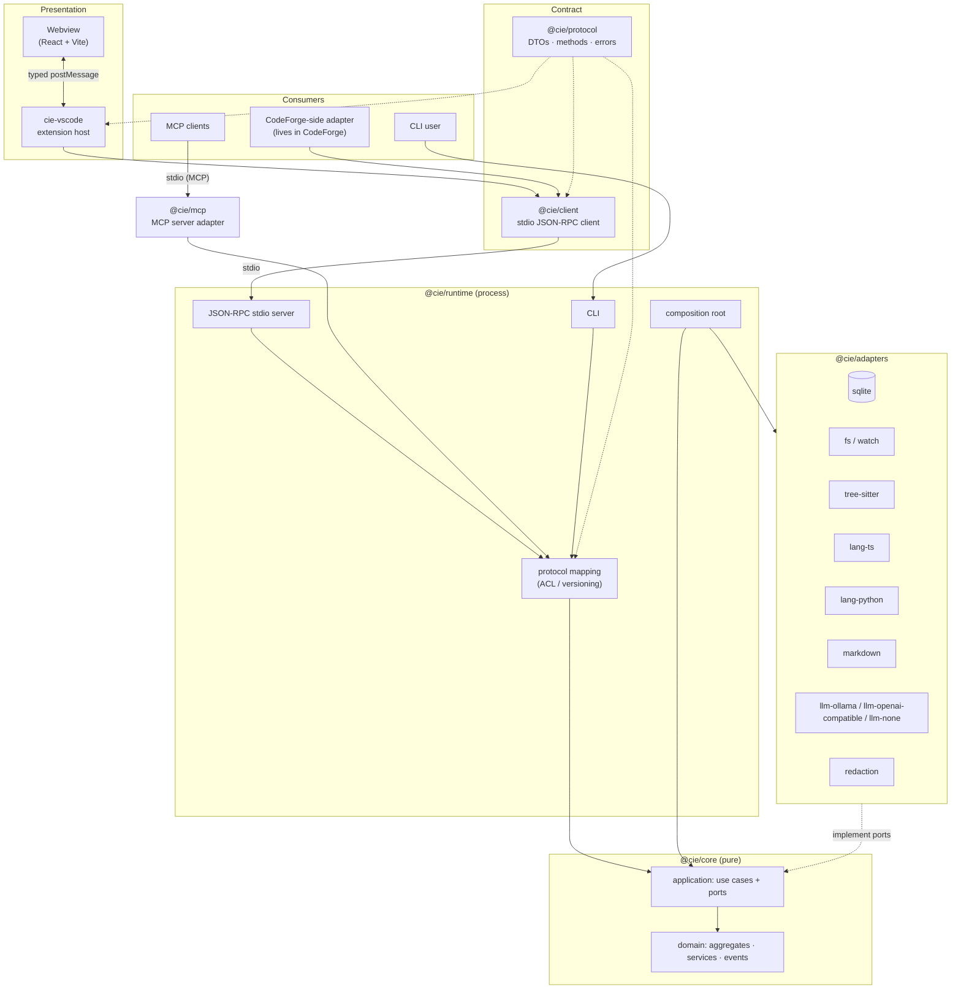
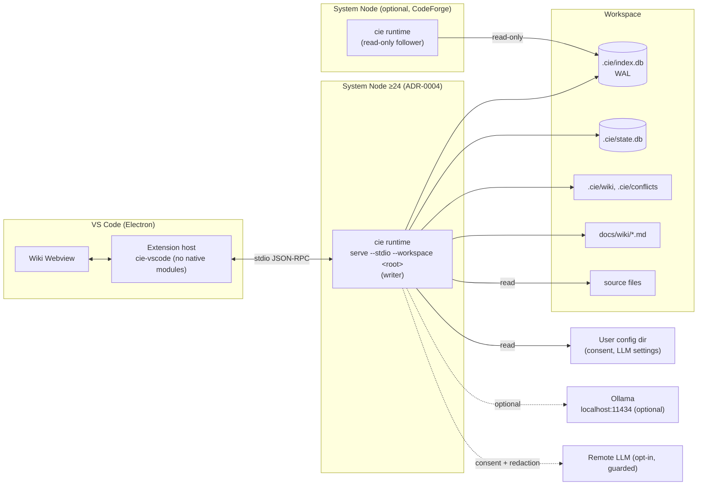
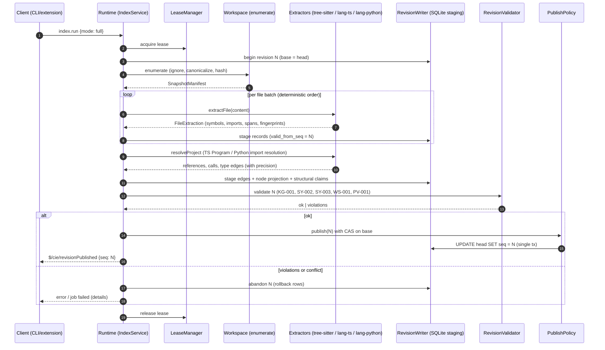
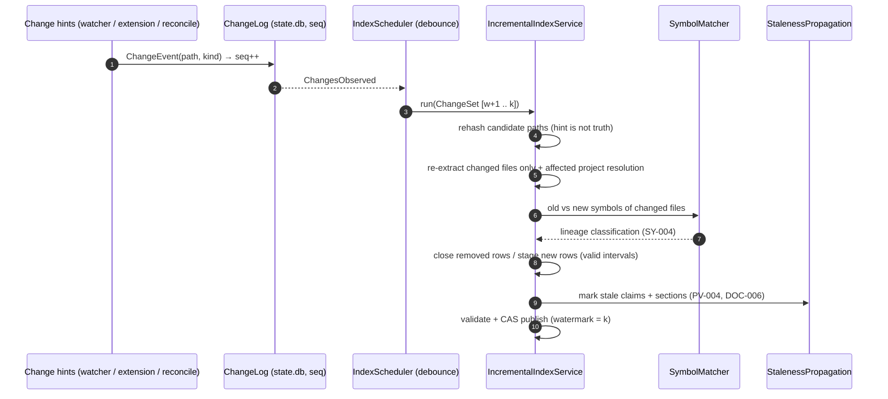
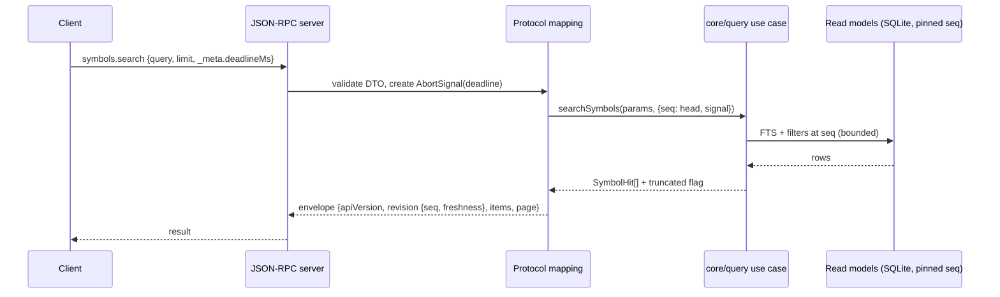
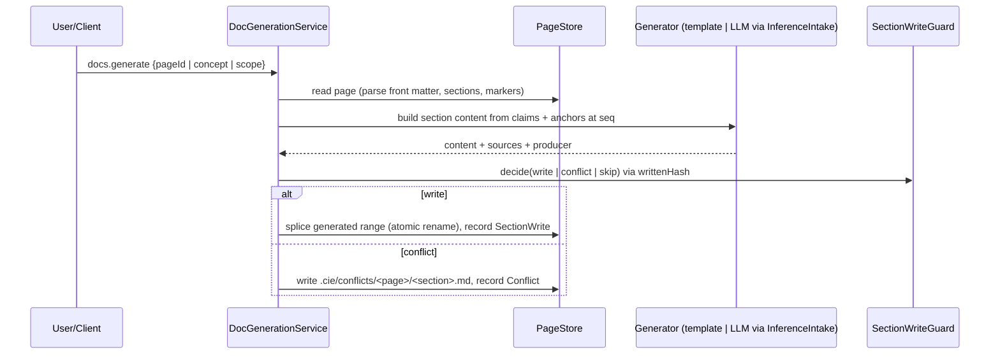

# System Architecture

> Status: Baseline v0.1 · Related: ADR-0001, ADR-0002, ADR-0003, ADR-0008, ADR-0015, [DEPENDENCY_RULES](DEPENDENCY_RULES.md)

## 1. Architectural style

CIE is a **modular monolith** (ADR-0001) with **hexagonal layering**:

| Layer | Lives in | Depends on | Contains |
|---|---|---|---|
| Domain | `@cie/core/<context>/domain` | shared-kernel only | Aggregates, value objects, domain services, events. Pure TypeScript: no I/O and no Node built-ins. |
| Application | `@cie/core/<context>/application`, `@cie/core/query` | Own domain, other contexts' `public.ts`, port interfaces | Use cases, ports (interfaces), unit-of-work orchestration, in-process event dispatch |
| Infrastructure (driven adapters) | `@cie/adapters/*` | `@cie/core` public ports, Node built-ins, third-party libs | SQLite, filesystem, watcher, tree-sitter, TS compiler, Markdown, LLM, redaction |
| Composition and transports (driving adapters) | `@cie/runtime`, `@cie/mcp` | core + adapters + protocol | Composition root, JSON-RPC stdio server, CLI, MCP server, protocol mapping |
| Contract | `@cie/protocol` | nothing | Versioned DTOs, method catalog, error codes |
| Client | `@cie/client` | `@cie/protocol`, Node built-ins | Spawns and talks to the runtime over stdio |
| Presentation | `cie-vscode` (extension host + React Webview) | `@cie/protocol`, `@cie/client`, `vscode`, React | UI only, no business logic |

## 2. Layer and hexagon diagram



## 3. Runtime topology (MVP)



| Rule | Source |
|---|---|
| One writer runtime per workspace. Followers serve queries only. | SN-004, ADR-0002 |
| The extension host never opens SQLite. | FR-080, E-27 |
| Ollama and cloud are optional. With `llm-none` there are no network sockets. | NFR-015 |

## 4. Data flows

### 4.1 Full index (Phase 01–03)



### 4.2 Incremental sync (Phase 05)



### 4.3 Query



### 4.4 Documentation generation (Phase 04 template / Phase 07 LLM)



### 4.5 Source navigation

See [VSCODE_EXTENSION_DESIGN §6](VSCODE_EXTENSION_DESIGN.md#6-symbol-accurate-source-navigation): anchor resolution, then a document-symbol cross-check, then reveal.

## 5. Proposed repository structure

```
codebase-intelligence-engine/
├── package.json                  # npm workspaces, engines.node ">=24 <27", private, license UNLICENSED (ADR-0013)
├── package-lock.json
├── .npmrc                        # save-exact=true, engine-strict=true
├── tsconfig.base.json            # strict, NodeNext, noUncheckedIndexedAccess, exactOptionalPropertyTypes
├── tsconfig.json                 # solution file with project references
├── eslint.config.js              # flat config + boundary guards (FF-DEP-*)
├── .dependency-cruiser.cjs       # FF-DEP / FF-BND rules
├── vitest.config.ts              # deterministic sequencing
├── governance/
│   ├── invariants.yaml
│   ├── invariants.schema.json
│   ├── fitness.yaml
│   ├── shared-kernel.allowlist
│   └── phase_00_checklist.yaml   # one per phase thereafter
├── scripts/
│   ├── check-governance.mjs      # schema + test-presence + no-removal checks
│   └── bench/                    # benchmark harness entry points (Phase 01+)
├── packages/
│   ├── protocol/      src/v1/{dto,methods,errors,envelope}.ts, index.ts
│   ├── core/          src/{shared-kernel,workspace,code-intelligence,knowledge,documentation,synchronization,query}/
│   ├── adapters/      src/{sqlite,fs,watch,process,treesitter,lang-ts,lang-python,markdown,llm-none,llm-ollama,llm-openai-compatible,redaction,config}/
│   ├── runtime/       src/{composition,protocol-mapping,jsonrpc,cli}/
│   ├── client/        src/ (Phase 06)
│   ├── mcp/           src/ (Phase 09)
│   └── vscode-extension/
│       ├── src/host/            # extension host (esbuild → CJS, external vscode)
│       ├── src/shared/messages.ts  # typed Webview protocol
│       └── webview/             # React + Vite app
├── tests/
│   ├── invariants/<prefix>/<id>.spec.ts
│   ├── fitness/                 # architecture tests (ArchUnitTS optional, custom)
│   ├── contracts/               # protocol contract suite (JSON-RPC + MCP)
│   ├── golden/                  # extraction and graph snapshots
│   ├── adversarial/             # path traversal, prompt injection, malformed markers
│   ├── cross-platform/
│   └── migration/
├── fixtures/                    # small hand-written repos (ts-basic, py-basic, mixed, edge-cases)
├── benchmarks/                  # fixture manifest (pinned SHAs), results schema
└── docs/
    ├── planning/                # this package
    └── wiki/                    # CIE's own curated wiki (dogfooding)
```

## 6. Composition root (`@cie/runtime/composition`)

There is one function per deployment mode. The core receives everything through ports.

```ts
// Specification sketch, not product code.
export interface RuntimeOptions {
  workspaceRoot: string;               // absolute
  mode: 'writer' | 'follower';
  llm: LlmSettings;                    // from user config only (SEC-005)
  limits: ServerLimits;                // maxLimit, maxDepth, deadlines
}

export function composeOutOfProcessRuntime(opts: RuntimeOptions): Runtime {
  const fs        = new GuardedFileSystem(opts.workspaceRoot);          // WS-002, SEC-002
  const stores    = openStores(fs, { index: '.cie/index.db', state: '.cie/state.db' }); // WS-003, migrations
  const hasher    = new Sha256Hasher();
  const clock     = new SystemClock();
  const adapters  = [new TreeSitterTsExtractor(), new TreeSitterPyExtractor()];
  const resolvers = [new TsCompilerResolver(), new PythonImportResolver()];
  const llm       = guardRemote(selectProvider(opts.llm), consentStore, redactor); // SEC-003
  const core      = createCore({ fs, stores, hasher, clock, adapters, resolvers, llm, limits: opts.limits });
  recover(core);                                                        // SN-005
  return { core, handler: createProtocolHandler(core) };                // shared by JSON-RPC and MCP
}
// Future (DEF): composeInProcessRuntime() wiring WASM / node:sqlite adapters (ADR-0002).
```

## 7. Port catalog

| Port | Declared in | MVP adapter(s) | Phase |
|---|---|---|---|
| `FileSystem` (read, stat, realpath, list; guarded write) | core/workspace | `adapters/fs` | 01 |
| `ChangeSource` | core/synchronization | `adapters/watch` (fs.watch, A-07), client hints, reconcile scanner | 05 (hints/reconcile), 01 (explicit) |
| `Clock`, `Hasher` | shared-kernel | `adapters/fs` (system clock, node:crypto) | 00 types / 01 impl |
| `WorkspaceRepository` | core/workspace | `adapters/sqlite` + `.cie/workspace.json` | 01 |
| `ConfigSource` | core/workspace (application) | `adapters/config` (workspace allow-list + user config) | 01 |
| `RevisionStore`, `RevisionWriter`, `LeaseManager`, `JobRepository` | core/synchronization | `adapters/sqlite` | 01 |
| `FileExtractor` | core/code-intelligence | `adapters/treesitter` (TS, TSX, JS, Python) | 02 |
| `ProjectResolver` | core/code-intelligence | `adapters/lang-ts`, `adapters/lang-python`; later `adapters/scip` | 02–03 |
| `SymbolReadModel`, `GraphReadModel`, `SearchIndex` | core/code-intelligence, core/knowledge | `adapters/sqlite` | 02–03 |
| `ClaimRepository` | core/knowledge | `adapters/sqlite` | 03 |
| `PageStore`, `PageParser` | core/documentation | `adapters/fs` + `adapters/markdown` | 04 |
| `LlmProvider` | core/knowledge (application) | `llm-none`, `llm-ollama`, `llm-openai-compatible` (guarded) | 07 (`llm-none` from 01) |
| `SecretRedactor` | core/knowledge (application) | `adapters/redaction` | 07 |
| `ProcessRunner` | core/code-intelligence (application) | `adapters/process` (exception register only) | 08+ |

No port exists without a concrete adapter scheduled in the roadmap (brief §14, rule 7).

## 8. Can the core run without VS Code or an LLM?

- **Without VS Code: yes.** The CLI (`cie index`, `cie query`) and `@cie/client` reach the same `ProtocolHandler`. VS Code is just one client (§2), and FF-DEP-003 forbids `vscode` imports outside `packages/vscode-extension`.
- **Without an LLM: yes.** `llm-none` is the default. Template generators (FR-044) and every structural capability are LLM-free, and AI-004 makes this a CI-enforced invariant.

## 9. Concurrency and threading

- One writer per workspace, through the lease.
- Extraction uses `worker_threads` for CPU-bound parsing **inside adapters only** ([Proposal], Phase 05 optimization, measured first). Workers return plain FileExtraction value objects, so the core stays single-threaded and deterministic: results are merged in path order.
- SQLite runs in WAL mode. Readers pin `seq` at request start.
